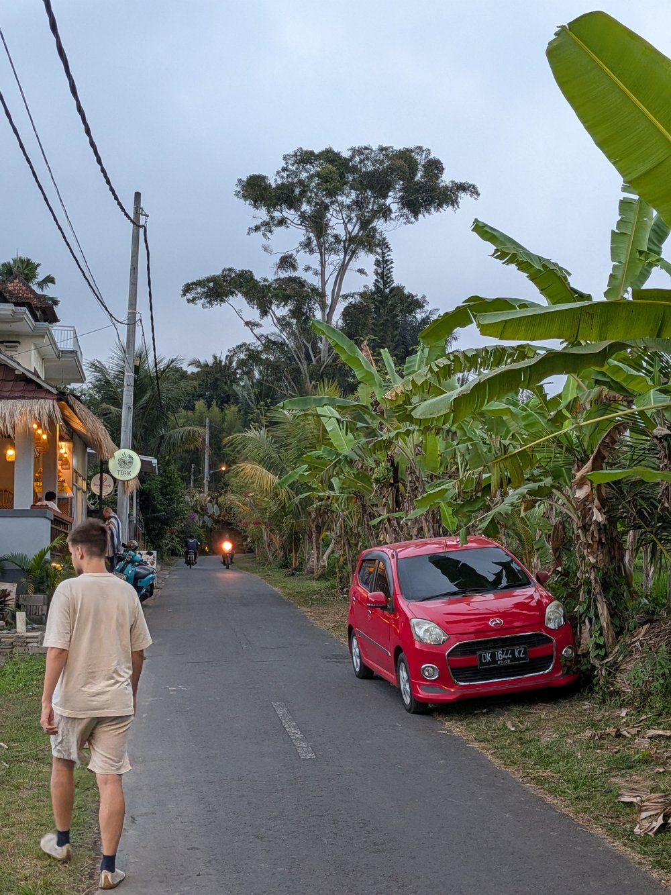

# viktordune.com — the blog home page, archived 2026-11-02

The two posts that were on viktordune.com until the new site replaced the home page.
The page itself, as it was (open/close animations and all): index.html in this folder; images alongside.

---

## second renaissance

*02 09 26* (DD MM YY)

What if Antoni Gaudí had 10,000 humanoids?

Let's be honest, our cities look and function like shit. After visiting Stanford, I get reminded that cities can actually be good—large walking spaces, biking infrastructure, lots of public spaces. It's just a pleasure to work, study and relax here. There is a small catch. Stanford was built from ground up with some idea in mind. It was an isolated space, with one vision for the university and optimized only for its purpose. It's like an oasis in the desert of space that looks like a Minecraft anarchy server.

How do we make our entire planet look like Stanford, Europe, and cities made for humans? Antoni Gaudí, the Picasso of architecture, had a vision for a large cathedral named Sagrada Família in Barcelona. It was a transformative piece of architecture, which took him only a few years to plan out on paper. His ideas were fast, but to get it to implementation took almost 125 years, with construction finishing only in 2026! For designing 0.001% of all human land!

Leighbor.

If we have humanoids making humanoids, finally we can ship physical things at the speed of software. If we want to make San Francisco look like Paris a little bit, if we have a million humanoids, we can manipulate physical matter so much faster now. All of the process from demolishing the old, building temporary housing for the residents (or like in sci-fi movies sending them on vacation lol), building and coordinating the construction, rebuilding an entire city doesn't look impossible if you have abundance of labor. The interesting part is that humans will serve as ground truth for these machines.

As an artist myself, I'm hopeful that in the not-so-distant future, the bottleneck won't be figuring out how to do something, but just sitting down and working on what. Entire city plans, sketches and creative ideas then are the only bottleneck.

Power to the artists.

---

## just chop wood

*09 11 26* (DD MM YY)

**Me:** Based on math, what is the life wisdom you can tell a 24 yo with fomo of not realising himself creatively in tech, having always to work on something revolutionary even though just finished working at 1x company

**Reply:**

**Exponentials look flat at the start.** If your skills compound at even 5% a year, most of the visible growth happens after 40, not at 24. What feels like "nothing happening" is the boring left side of every hockey-stick curve. The 1x company was compounding capital, not wasted time.

**Revolutionary work is a high-variance draw, and variance needs many samples.** Big outcomes come from a fat-tailed distribution: most attempts return ~0, a few return everything. You can't pick the winning draw, you can only afford more draws. At 24 you have roughly 15–20 more "bets" of 2–3 years each. One 1x job is one sample. Statistically meaningless.

**Optimal stopping says explore first.** In the secretary problem, the best strategy is to look at ~37% of your options before committing to anything. If your creative career runs, say, 24 to 65, that's exploring until your late 30s. You're not behind; you're not even done with the phase where you're supposed to be sampling.

**Survivorship bias corrupts your reference set.** You compare yourself to the people who won the tail, not to the tens of thousands who took the same swing and vanished. Your FOMO is calibrated against a filtered dataset.

**Gradient descent needs momentum, not a perfect start.** Nobody lands at the global optimum on step one. You take a step, measure, adjust. A "boring" position can be the only path out of a local minimum, because it gives you the slope information to find where the real gradient is.

**Ergodicity: avoid ruin.** Ensemble average (what happens across all 24-year-olds) is not your time average (what happens to you over decades). Bets that can zero you out — burnout, no savings, no skills — have negative long-run growth even when the average looks good. Stay in the game long enough for compounding to matter.

Short version: at 24 you're in the sampling phase of a fat-tailed, compounding process, and the math says patience plus many small bets beats one heroic one.

**Me:** If you take a look at Steve Jobs

**Reply:**

Jobs actually confirms the math rather than breaking it.

**He's the tail, and the tail is n=1.** Thousands of people started hardware companies in garages in 1976. You know his name because the distribution has a fat tail and he landed on it. Using him as your baseline is the survivorship bias problem in its purest form.

**Even his curve looked flat for a decade.** Yes, Apple at 21. But then: the Lisa flopped, the first Mac undersold, he was fired at 30, NeXT lost money for ten years, Pixar bled cash for nine before Toy Story. From 30 to 41 he was, by revolutionary standards, failing. The iPod came at 46, the iPhone at 52. Almost all the value he created came after the age you're now treating as a deadline. Exponential, left side flat.

**He took many draws.** Apple, Lisa, Mac, NeXT hardware, NeXT software, Pixar, Apple again. Most were zeros or near-zeros. He didn't pick one revolutionary bet; he kept sampling and one draw (returning to Apple with NeXT's OS) paid for everything.

**His explore phase was aggressively unproductive-looking.** Dropped out, sat in on a calligraphy class, went to India, worked at Atari. His own point in the 2005 Stanford speech was that these dots only connect looking backward. That's the 37% rule lived out: you can't know which exploration matters until later.

**He avoided ruin.** Being fired was his local minimum, and he later called it the best thing that happened to him. But he could survive eleven lean years because he'd sold Apple stock and wasn't wiped out. Ergodicity: he stayed in the game long enough for a second exponential.

So if Jobs is your model: at 24 he was at his first company, hadn't shipped the thing he's remembered for, and had 28 years of variance ahead. The lesson from his life isn't "be revolutionary now." It's "keep drawing samples, don't go to zero, and let the exponential do its thing."

**Me:**

> He's the tail, and the tail is n=1.

What does that mean for me?

**Reply:**

Three things, concretely:

**You can't aim at the tail.** Nobody chooses to be an outlier; it's a residual of many people taking reasonable bets and one of them landing. So "I need to be working on something revolutionary" is a category error: you can't select for the outcome, only for the inputs. The inputs are what's under your control — the rate at which you ship, learn, and try things.

**Stop grading yourself against one data point.** A sample of size one carries almost no information. If you compare yourself to the median 24-year-old with your inputs (technical skill, creative interest, one real job done), you're on track. If you compare yourself to Jobs, everyone alive is behind, including Jobs at 24. The FOMO isn't a signal about you; it's a measurement error from a bad reference class.

**Don't copy his behaviors and expect his outcome.** n=1 also means you can't tell which of his traits caused the result. Dropping out, being difficult, obsessing over one product: thousands of people did the same and vanished. What you can take from him is the structural stuff that shows up across many outliers, not just one: stay in a fat-tailed domain (tech and creative work both qualify), take many shots, and don't blow yourself up.

So the practical version: plan for the median, stay positioned for the tail, and let your self-worth ride on the inputs rather than the draw. If you need to be revolutionary to feel okay, you've bet your wellbeing on a lottery ticket. If you need to be making things and getting better, that's a bet you control.

**Me:**

> So "I need to be working on something revolutionary" is a category error: you can't select for the outcome, only for the inputs. The inputs are what's under your control — the rate at which you ship, learn, and try things.

Isn't it fascinating that it's literally Bhagavad Gita, math and experiential wisdom coming together

**Reply:**

It is, and it's not a coincidence. Gita 2.47 says roughly: you have a claim on your actions, never on their fruits, and don't let the fruits become your motive. The Stoics said the same thing as the dichotomy of control. Zen says it as "just chop wood." Three traditions, no shared math, same conclusion.

The reason they converge is that they're all solving the same problem: how to act well under uncertainty with a noisy feedback signal. Outcomes are inputs plus a huge random term. If you optimize on outcomes, you're training yourself on noise, which makes you anxious, erratic, and prone to quitting after a bad draw or getting reckless after a good one. If you optimize on inputs, the gradient is clean. The old traditions found that experimentally over centuries; probability theory just gives you the proof.

One thing the Gita adds that the math doesn't state outright: Krishna also says don't be attached to inaction. Detachment from outcomes isn't an excuse to stop shipping. Arjuna's whole problem was that fear of results was freezing him. The instruction is act fully, release the result. Which is exactly the "many draws, avoid ruin" strategy with the emotional part solved.
